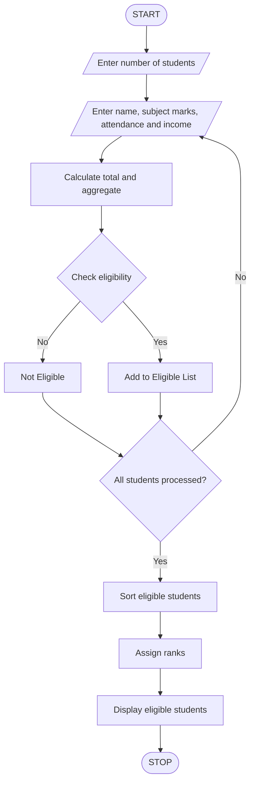

## 1. Problem Statement

The University Scholarship Allocation System is designed to evaluate students based on their academic performance, subject-wise marks, attendance percentage, and family income.

The system checks whether students satisfy all scholarship eligibility criteria. Eligible students are ranked according to their aggregate marks. If two or more students have the same aggregate marks, attendance percentage is used to resolve the tie. If attendance is also equal, the student with higher subject marks is given priority.

The system displays the list of eligible students along with their scholarship ranks.

## 2. Algorithm

1. Start the program.
2. Enter the number of students.
3. Enter each student's name.
4. Enter marks in three subjects.
5. Calculate aggregate percentage.
6. Enter attendance percentage.
7. Enter annual family income.
8. Check scholarship eligibility:
   - Aggregate marks must be at least 75%.
   - Each subject mark must be at least 60.
   - Attendance must be at least 75%.
   - Annual family income must not exceed ₹3,00,000.
9. Store eligible students.
10. Sort eligible students based on:
    - Highest aggregate percentage.
    - Highest attendance.
    - Highest total subject marks.
11. Assign ranks.
12. Display eligible students and their ranks.
13. Stop.

## 3. Flowchart



## 4. Sample Input

```
Enter number of students: 3

Enter details of student 1
Enter student name: Pujitha
Enter subject 1 marks: 90
Enter subject 2 marks: 85
Enter subject 3 marks: 95
Enter attendance percentage: 90
Enter annual family income: 200000

Enter details of student 2
Enter student name: Dinesh
Enter subject 1 marks: 80
Enter subject 2 marks: 85
Enter subject 3 marks: 90
Enter attendance percentage: 85
Enter annual family income: 250000

Enter details of student 3
Enter student name: Priya
Enter subject 1 marks: 50
Enter subject 2 marks: 80
Enter subject 3 marks: 90
Enter attendance percentage: 90
Enter annual family income: 200000
```

## 5. Sample Output

```
Priya is not eligible for scholarship

----- SCHOLARSHIP ELIGIBLE STUDENTS -----

Rank: 1
Name: Pujitha
Total Marks: 270
Aggregate: 90.0 %
Attendance: 90.0 %

Rank: 2
Name: Dinesh
Total Marks: 255
Aggregate: 85.0 %
Attendance: 85.0 %
```


Note: The eligibility limits and tie-breaking rules used here are sample rules for the Python assignment. You can change them according to your university requirements.
