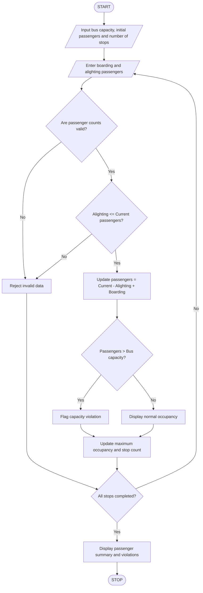

## 1. Problem Statement

Develop a Python program to simulate passenger occupancy in a bus across multiple stops. The program should process the number of passengers boarding and alighting at each stop, calculate the total passengers inside the bus, and check whether the bus exceeds its maximum seating capacity. It should flag capacity violations and display the passenger count at every stop.

## 2. Algorithm

1. Start the program.
2. Enter the maximum bus capacity.
3. Enter the initial number of passengers.
4. Enter the number of bus stops.
5. Initialize the total passenger count.
6. For each stop:
   - Enter the number of passengers boarding.
   - Enter the number of passengers alighting.
   - Check whether the inputs are valid.
   - Check whether alighting passengers are less than or equal to current passengers.
   - Subtract alighting passengers.
   - Add boarding passengers.
   - Calculate the current passenger count.
7. Check whether passenger count exceeds bus capacity.
8. If capacity is exceeded, display a capacity violation.
9. Otherwise, display normal occupancy.
10. Display passenger details at every stop and the maximum occupancy.
11. Stop.

## 3. Flowchart



## 4. Sample Input

```
Enter bus capacity: 50
Enter initial passengers: 20
Enter number of stops: 4

Stop 1
Enter boarding passengers: 15
Enter alighting passengers: 5

Stop 2
Enter boarding passengers: 20
Enter alighting passengers: 10

Stop 3
Enter boarding passengers: 15
Enter alighting passengers: 5

Stop 4
Enter boarding passengers: 10
Enter alighting passengers: 5
```

## 5. Sample Output

```
BUS PASSENGER OCCUPANCY SIMULATION

Stop 1
Normal occupancy.
Current passengers: 30

Stop 2
Normal occupancy.
Current passengers: 40

Stop 3
Normal occupancy.
Current passengers: 50

Stop 4
Capacity violation!
Current passengers: 55

----- BUS SUMMARY -----
Final passengers: 55
Maximum occupancy: 55
Capacity violations: 1
Available seats: -5
```


