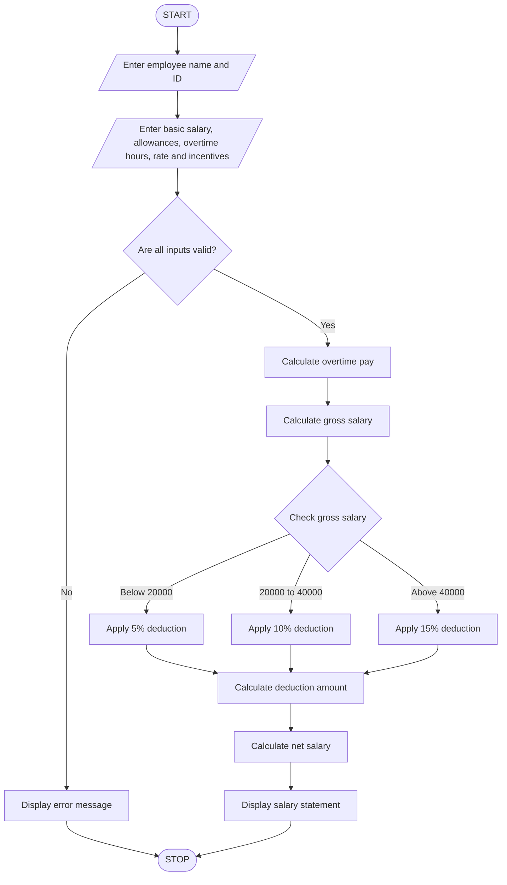

## 1. Problem Statement

The Employee Payroll and Deduction Analysis System is designed to calculate the gross salary of an employee based on basic pay, allowances, overtime, and incentives.

The system calculates total earnings and applies progressive deductions based on the salary amount. It calculates the net salary after deductions and generates a formatted salary statement containing employee details, gross salary, deductions, and final payable salary.

## 2. Algorithm

1. Start the program.
2. Enter employee name and employee ID.
3. Enter basic salary.
4. Enter allowances.
5. Enter overtime hours and overtime rate.
6. Enter incentives.
7. Calculate overtime pay.
8. Calculate gross salary.
9. Apply progressive deductions:
   - If gross salary is below ₹20,000, deduction is 5%.
   - If gross salary is ₹20,000 to ₹40,000, deduction is 10%.
   - If gross salary is above ₹40,000, deduction is 15%.
10. Calculate deduction amount.
11. Calculate net salary.
12. Display the formatted salary statement.
13. Stop the program.

## 3. Flowchart



## 4. Sample Input

```
Enter employee name: Pujitha
Enter employee ID: 101

Enter basic salary: 25000
Enter allowances: 5000
Enter overtime hours: 10
Enter overtime rate: 200
Enter incentives: 3000
```

## 5. Sample Output

```
===== EMPLOYEE SALARY STATEMENT =====

Employee Name: Pujitha
Employee ID: 101

Basic Salary: Rs. 25000.0
Allowances: Rs. 5000.0
Overtime Pay: Rs. 2000.0
Incentives: Rs. 3000.0

------------------------------------
Gross Salary: Rs. 35000.0
Deduction Rate: 10 %
Deduction Amount: Rs. 3500.0
------------------------------------

Net Salary: Rs. 31500.0

====================================
```

