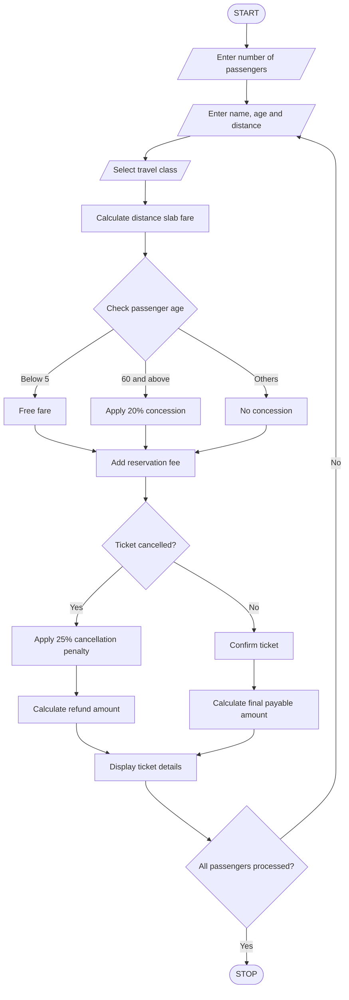

## 1. Problem Statement

The Railway Fare and Reservation Calculator is designed to calculate railway ticket fares for multiple passengers based on travel distance, travel class, age-based concessions, reservation fees, and cancellation penalties.

The system accepts passenger details, calculates the basic fare using distance slabs, applies class-wise fare rates and age-based concessions, and adds reservation fees. It also calculates cancellation charges when a passenger cancels a ticket.

Finally, the program displays a detailed ticket statement containing passenger details, ticket fare, concession, reservation fee, cancellation penalty, and final payable amount.

## 2. Algorithm

1. Start the program.
2. Enter the number of passengers.
3. Enter passenger name and age.
4. Enter travel distance in kilometres.
5. Select travel class:
   - Sleeper – ₹2 per km.
   - AC 3 Tier – ₹3 per km.
   - AC 2 Tier – ₹4 per km.
6. Calculate basic fare using distance slabs:
   - First 100 km – 100% fare.
   - Next 100 km – 90% fare.
   - Above 200 km – 80% fare.
7. Apply age-based concessions:
   - Below 5 years – Free.
   - Age 60 and above – 20% concession.
   - Other passengers – No concession.
8. Add reservation fee of ₹50.
9. Ask whether the passenger wants to cancel the ticket.
10. If cancelled, apply a 25% cancellation penalty on the fare after concession.
11. Calculate the final amount.
12. Display passenger ticket details.
13. Repeat for all passengers.
14. Stop the program.

## 3. Flowchart



## 4. Sample Input

```
Enter number of passengers: 2

Enter passenger details
Enter passenger name: Pujitha
Enter passenger age: 65
Enter distance in km: 250

1. Sleeper
2. AC3
3. AC2
Select travel class: 1

Cancel ticket? (yes/no): no

Enter passenger details
Enter passenger name: Dinesh
Enter passenger age: 30
Enter distance in km: 150

1. Sleeper
2. AC3
3. AC2
Select travel class: 2

Cancel ticket? (yes/no): yes
```

## 5. Sample Output

```
----- RAILWAY TICKET -----

Passenger Name: Pujitha
Age: 65
Distance: 250.0 km
Travel Class: Sleeper
Basic Fare: Rs. 380.0
Concession: Rs. 76.0
Reservation Fee: Rs. 50
Total Fare: Rs. 354.0
Ticket Status: Confirmed
Cancellation Penalty: Rs. 0
Final Payable Amount: Rs. 354.0

--------------------------

----- RAILWAY TICKET -----

Passenger Name: Dinesh
Age: 30
Distance: 150.0 km
Travel Class: AC3
Basic Fare: Rs. 435.0
Concession: Rs. 0
Reservation Fee: Rs. 50
Total Fare: Rs. 485.0
Ticket Status: Cancelled
Cancellation Penalty: Rs. 108.75
Refund Amount: Rs. 376.25

--------------------------
```


