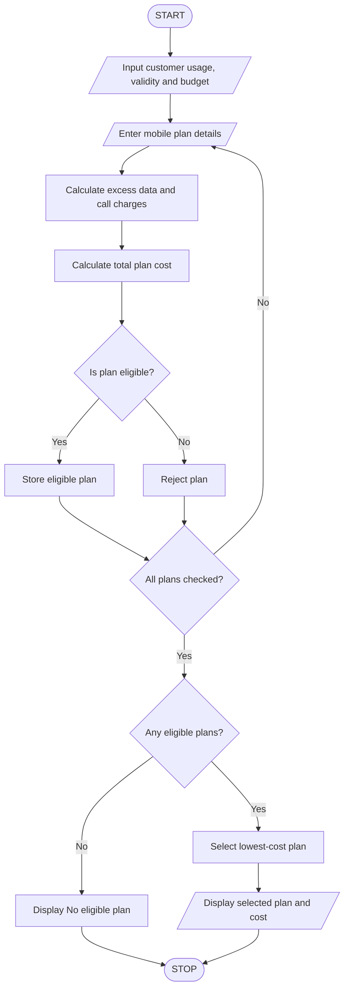

## 1. Problem Statement

The Multi-Plan Telecommunications Cost Optimization System is designed to compare multiple mobile recharge plans based on data usage, call minutes, validity period, and budget constraints.

The system accepts customer usage details and evaluates different mobile plans. It calculates excess charges when the customer exceeds the available data or call limits. It checks whether each plan satisfies the customer's usage requirements, validity requirements, and budget.

Finally, the program identifies the most economical eligible plan and displays the plan details, total cost, excess charges, and savings.

## 2. Algorithm

1. Start the program.
2. Enter the customer's name.
3. Enter monthly data usage in GB.
4. Enter monthly call usage in minutes.
5. Enter required validity in days.
6. Enter the customer's budget.
7. Enter the number of mobile plans.
8. For each plan, enter:
   - Plan name.
   - Plan price.
   - Data limit.
   - Call limit.
   - Validity days.
   - Excess data charge per GB.
   - Excess call charge per minute.
9. Calculate excess data and call charges.
10. Calculate the total plan cost.
11. Check usage, validity, and budget constraints.
12. Store eligible plans.
13. Compare eligible plans based on total cost.
14. Select the most economical plan.
15. Display the selected plan and its cost details.
16. If no plan is eligible, display a suitable message.
17. Stop the program.

## 3. Flowchart



## 4. Sample Input

```
Enter customer name: Pujitha

Enter monthly data usage (GB): 20
Enter monthly call usage (minutes): 500
Enter required validity days: 28
Enter your budget: 400

Enter number of mobile plans: 3

Enter Plan 1 Details
Enter plan name: Basic
Enter plan price: 199
Enter data limit (GB): 15
Enter call limit (minutes): 300
Enter validity days: 28
Excess data charge per GB: 20
Excess call charge per minute: 1

Enter Plan 2 Details
Enter plan name: Smart
Enter plan price: 299
Enter data limit (GB): 25
Enter call limit (minutes): 600
Enter validity days: 28
Excess data charge per GB: 15
Excess call charge per minute: 1

Enter Plan 3 Details
Enter plan name: Premium
Enter plan price: 399
Enter data limit (GB): 30
Enter call limit (minutes): 1000
Enter validity days: 56
Excess data charge per GB: 10
Excess call charge per minute: 1
```

## 5. Sample Output

```
----- PLAN COMPARISON -----

Plan: Basic
Total Cost: 599.0

Plan: Smart
Total Cost: 299.0

Plan: Premium
Total Cost: 399.0

----- BEST MOBILE PLAN -----

Customer Name: Pujitha
Best Plan: Smart
Total Cost: Rs. 299.0
Data Excess Charge: Rs. 0.0
Call Excess Charge: Rs. 0.0
Validity: 28 days
Remaining Budget: Rs. 101.0
```

