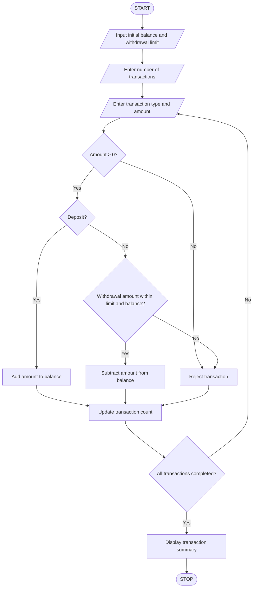

## 1. Problem Statement

Develop a Python program to simulate ATM transactions. The program should process a sequence of deposits and withdrawals, maintain the available account balance, enforce a maximum withdrawal limit, reject invalid transactions, and display a transaction summary. It should also calculate the total amount deposited, withdrawn, and the final account balance.

## 2. Algorithm

1. Start the program.
2. Enter the initial account balance.
3. Enter the maximum withdrawal limit.
4. Enter the number of transactions.
5. Repeat for each transaction:
   - Enter transaction type (Deposit or Withdrawal).
   - Enter transaction amount.
   - Check whether the amount is positive.
   - If it is a deposit, add the amount to the balance.
   - If it is a withdrawal:
     - Check whether the amount is within the withdrawal limit.
     - Check whether sufficient balance is available.
     - If both conditions are satisfied, subtract the amount.
     - Otherwise, reject the transaction.
6. Count successful and rejected transactions.
7. Calculate total deposits and withdrawals.
8. Display the transaction summary and final balance.
9. Stop.

## 3. Flowchart



## 4. Sample Input

```
Enter initial balance: 10000
Enter withdrawal limit: 5000
Enter number of transactions: 5

Transaction 1
Enter Deposit or Withdrawal: deposit
Enter amount: 2000

Transaction 2
Enter Deposit or Withdrawal: withdrawal
Enter amount: 3000

Transaction 3
Enter Deposit or Withdrawal: withdrawal
Enter amount: 6000

Transaction 4
Enter Deposit or Withdrawal: withdrawal
Enter amount: 2000

Transaction 5
Enter Deposit or Withdrawal: deposit
Enter amount: 1000
```

## 5. Sample Output

```
ATM TRANSACTION SIMULATION

Deposit successful.
Withdrawal successful.
Withdrawal limit exceeded!
Withdrawal successful.
Deposit successful.

----- TRANSACTION SUMMARY -----
Total Deposits: 3000.0
Total Withdrawals: 5000.0
Successful Transactions: 4
Rejected Transactions: 1
Final Balance: 8000.0
```

