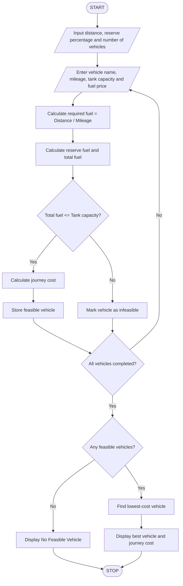

## 1. Problem Statement

Develop a Python program to calculate fuel requirements and journey costs for different vehicles based on travel distance, vehicle mileage, fuel price, and reserve fuel requirements. The program should check whether each vehicle has sufficient fuel capacity to complete the journey, including reserve fuel. It should compare all feasible vehicles and identify the vehicle with the lowest journey cost.

## 2. Algorithm

1. Start the program.
2. Enter the journey distance.
3. Enter the required reserve fuel percentage.
4. Enter the number of vehicles.
5. For each vehicle, enter:
   - Vehicle name.
   - Mileage (km/litre).
   - Fuel tank capacity (litres).
   - Fuel price per litre.
6. Calculate required fuel:

&#x20;  Required fuel = Distance / Mileage

7\. Calculate reserve fuel:

&#x20;  Reserve fuel = Required fuel × Reserve percentage / 100

8\. Calculate total fuel needed:

&#x20;  Total fuel = Required fuel + Reserve fuel

9. Check whether the vehicle's tank capacity is sufficient.
10. If sufficient, calculate journey cost and mark the vehicle as feasible.
11. Otherwise, reject the vehicle as infeasible.
12. Compare the costs of all feasible vehicles.
13. Display the lowest-cost vehicle and its journey cost.
14. If no vehicle is feasible, display a suitable message.
15. Stop.

## 3. Flowchart


## 4. Sample Input

```
Enter journey distance (km): 300
Enter reserve percentage: 10
Enter number of vehicles: 3

Vehicle 1
Enter vehicle name: Car
Enter mileage (km/l): 15
Enter tank capacity (litres): 40
Enter fuel price per litre: 105

Vehicle 2
Enter vehicle name: Bike
Enter mileage (km/l): 40
Enter tank capacity (litres): 15
Enter fuel price per litre: 105

Vehicle 3
Enter vehicle name: SUV
Enter mileage (km/l): 10
Enter tank capacity (litres): 25
Enter fuel price per litre: 105
```

## 5. Sample Output

```
FUEL CONSUMPTION AND ROUTE COMPARISON

Vehicle is feasible.
Total fuel needed: 22.0
Journey cost: Rs. 2100.0

Vehicle is feasible.
Total fuel needed: 8.25
Journey cost: Rs. 787.5

Vehicle is not feasible.
Required fuel: 33.0

----- JOURNEY SUMMARY -----
Lowest-cost vehicle: Bike
Total fuel needed: 8.25 litres
Lowest journey cost: Rs. 787.5
```

