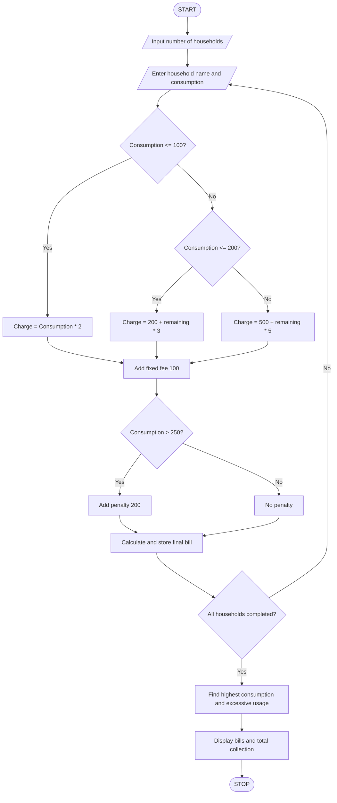

## 1. Problem Statement

Develop a Python program to calculate water bills for multiple households based on their water consumption. The program should apply progressive consumption slabs, fixed monthly fees, and penalties for excessive usage. It should compare household consumption patterns, calculate the total bill for each household, identify excessive water usage, and display the household with the highest consumption.

## 2. Algorithm

1. Start the program.
2. Enter the number of households.
3. Set the water consumption slabs:
   - First 100 litres: ₹2 per litre.
   - Next 100 litres: ₹3 per litre.
   - Above 200 litres: ₹5 per litre.
4. Set the fixed monthly fee as ₹100.
5. Set the excessive usage limit as 250 litres.
6. For each household:
   - Enter household name.
   - Enter water consumption.
   - Calculate the bill according to consumption slabs.
   - Add the fixed monthly fee.
   - If consumption exceeds 250 litres, add a penalty of ₹200.
   - Calculate the final bill.
7. Store household consumption and bill details.
8. Compare consumption of all households.
9. Identify households with excessive usage.
10. Display household bills, highest consumption and total collection.
11. Stop.

## 3. Flowchart


## 4. Sample Input

```
Enter number of households: 3

Household 1
Enter household name: Pujitha
Enter water consumption: 80

Household 2
Enter household name: Dinesh
Enter water consumption: 180

Household 3
Enter household name: Mamatha
Enter water consumption: 300
```

## 5. Sample Output

```
PROGRESSIVE WATER TARIFF ANALYSIS

Water Bill: Rs. 260.0
Status: Normal Usage

Water Bill: Rs. 600.0
Status: Normal Usage

Water Bill: Rs. 1200.0
Status: Excessive Usage

----- WATER BILL SUMMARY -----

Pujitha 80.0 260.0 Normal Usage
Dinesh 180.0 600.0 Normal Usage
Mamatha 300.0 1200.0 Excessive Usage

Highest Consumption: Mamatha
Consumption: 300.0 litres

Total Collection: Rs. 2060.0

Excessive Usage Households:
Mamatha
```


