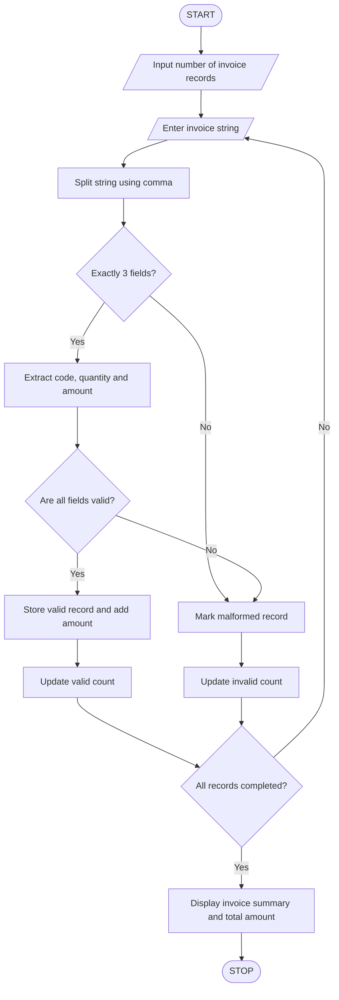

## 1. Problem Statement

Develop a Python program to process formatted invoice strings using basic string operations. The program should extract product codes, quantities, and amounts from invoice records. It should validate each record, identify malformed or invalid records, calculate the total invoice amount, and display a summary of valid and rejected records.

Invoice format:

`ProductCode,Quantity,Amount`

Example: `P101,2,500`

## 2. Algorithm

1. Start the program.
2. Enter the number of invoice records.
3. Initialize total amount, valid count and invalid count to zero.
4. Read each invoice record as a string.
5. Split the string using commas.
6. Check whether the record contains exactly three fields.
7. Extract product code, quantity and amount.
8. Validate the fields:
   - Product code should not be empty.
   - Quantity should be a positive integer.
   - Amount should be a positive number.
9. If all fields are valid:
   - Display product code, quantity and amount.
   - Add amount to the total invoice amount.
   - Increase valid count.
10. Otherwise, flag the record as malformed and increase invalid count.
11. Repeat until all records are processed.
12. Display valid records, invalid records and total amount.
13. Stop.

## 3. Flowchart



## 4. Sample Input

```
Enter number of invoice records: 4

Invoice 1
Enter invoice: P101,2,500

Invoice 2
Enter invoice: P102,3,750

Invoice 3
Enter invoice: P103,abc,400

Invoice 4
Enter invoice: P104,2
```

## 5. Sample Output

```
TEXT-BASED INVOICE DATA EXTRACTION

Invoice 1
Product Code: P101
Quantity: 2
Amount: Rs. 500.0

Invoice 2
Product Code: P102
Quantity: 3
Amount: Rs. 750.0

Invoice 3
Invalid quantity or amount!

Invoice 4
Malformed invoice record!

----- INVOICE SUMMARY -----
Valid Records: 2
Invalid Records: 2
Total Invoice Amount: Rs. 1250.0
```


