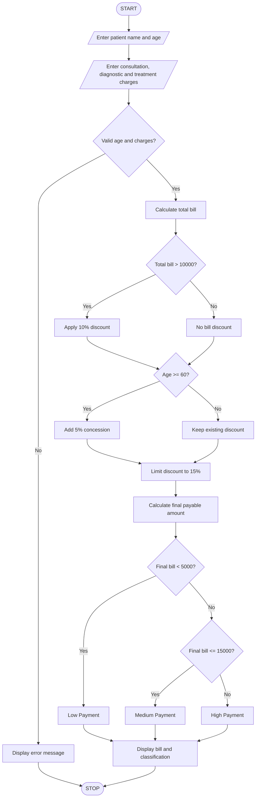

## 1. Problem Statement

The Hospital Billing and Patient Classification System is designed to calculate the total hospital bill based on consultation charges, diagnostic charges, and treatment charges.

The system applies conditional concessions based on the patient's category. It validates billing constraints, calculates the final payable amount, and classifies patients according to the payment policy.

The program displays the patient's details, total bill, discount, final amount, and payment classification.

## 2. Algorithm

1. Start the program.
2. Enter the patient's name and age.
3. Enter consultation charges.
4. Enter diagnostic charges.
5. Enter treatment charges.
6. Calculate the total bill.
7. Check the billing conditions:
   - If total bill is above ₹10,000, apply a 10% discount.
   - If patient age is 60 or above, apply an additional 5% concession.
   - Maximum discount is 15%.
8. Calculate the final bill after discount.
9. Classify the patient:
   - Below ₹5,000 – Low Payment.
   - ₹5,000 to ₹15,000 – Medium Payment.
   - Above ₹15,000 – High Payment.
10. Display the final bill and patient classification.
11. Stop the program.

## 3. Flowchart



## 4. Sample Input

```
Enter patient name: Pujitha
Enter patient age: 65

Enter consultation charges: 2000
Enter diagnostic charges: 4000
Enter treatment charges: 10000
```

## 5. Sample Output

```
--- HOSPITAL BILL ---

Patient Name: Pujitha
Patient Age: 65
Consultation Charges: 2000.0
Diagnostic Charges: 4000.0
Treatment Charges: 10000.0

Total Bill: 16000.0
Discount Percentage: 15 %
Discount Amount: 2400.0
Final Payable Amount: 13600.0

Patient Classification: Medium Payment
```

